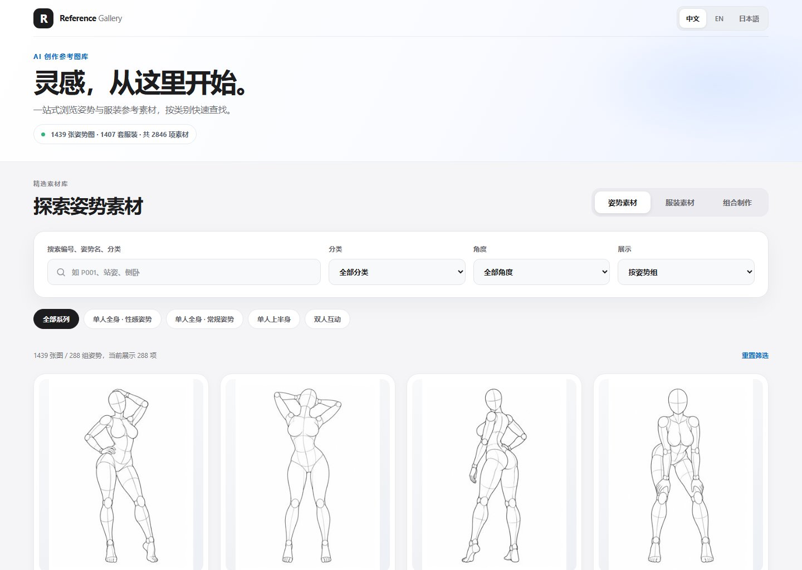
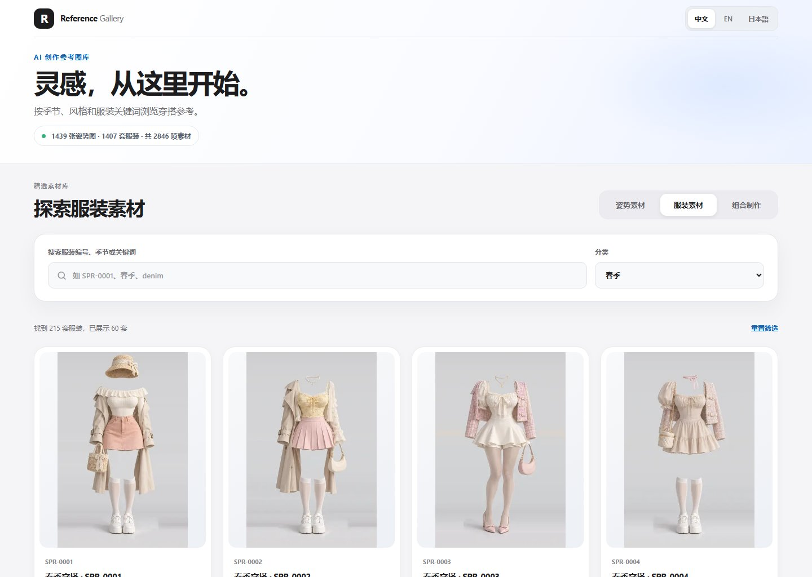
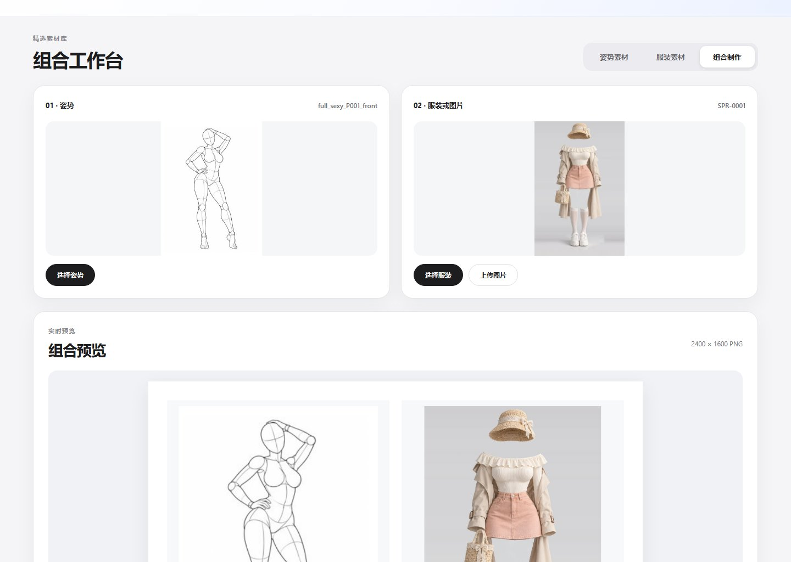
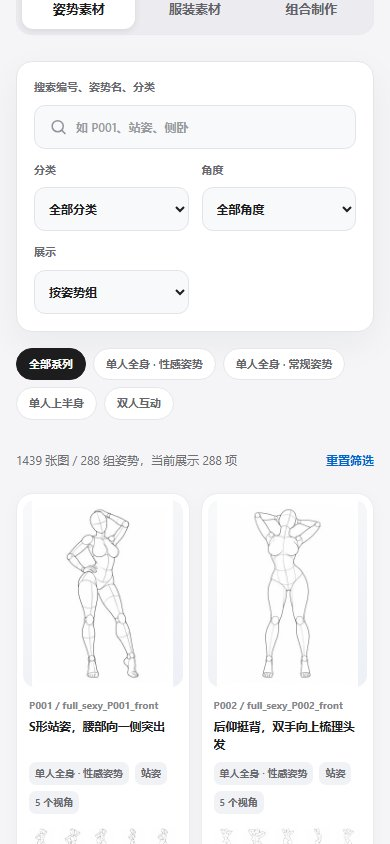

# AI Reference Gallery · AI 姿势与服装参考图库

> 收录 **288 组 / 1,439 张姿势参考图**与 **1,407 套服装参考素材**，支持中文 / English / 日本語，纯静态、零依赖、可离线使用。



## 效果预览

**服装图库**



**组合工作台**



<details>
<summary>查看手机端效果</summary>



</details>

## 功能特色

- **姿势参考**：支持按系列、动作类别、视角和关键词筛选，查看多角度原图。
- **服装参考**：支持按季节、风格、编号和关键词查找。
- **图片组合**：选择姿势与服装图片，或上传自己的图片，支持左右 / 上下拼接并下载 PNG。*仅为图片拼接，不是 AI 自动换装。*
- **多语言**：简体中文、英语、日语自由切换。
- **离线浏览**：原生 HTML / CSS / JavaScript，无后端、无运行依赖。

## 快速使用

```bash
git clone https://github.com/vculjp/ai-reference-gallery.git
cd ai-reference-gallery
```

克隆后直接双击 **`index.html`**，即可在浏览器中浏览和下载素材，仓库自带全部图片。

**本地组合导出**：通过 `file://` 打开时，浏览器可能要求访问图片目录。按照页面提示选择项目的 **`img` 文件夹**（内含 `pose/` 与 `costume/`），即可导出 PNG；通过同源 HTTP 网站访问则无需此步骤。

## 项目结构

```text
ai-reference-gallery/
├── index.html              # 网页入口
├── app.js                  # 图库浏览与筛选
├── composition*.js         # 图片组合与导出
├── style.css               # 页面样式
├── composition.css         # 组合工作台样式
├── i18n.js                 # 中英日多语言
├── catalog.js              # 姿势索引
├── costume-catalog.js      # 服装索引
├── img/
│   ├── pose/               # 姿势图片
│   └── costume/            # 服装图片
├── docs/                   # README 效果图
└── README.md
```

## 版权与致谢

- **代码**以 [MIT License](LICENSE) 开源；图片、缩略图及来源衍生素材索引不适用 MIT 代码许可，使用或再分发请查阅 [ASSETS.md](ASSETS.md)。
- **姿势素材来源**：[ai-pose-gallery](https://ai-pose-gallery.pages.dev/)（原作者：ギア / [@giaaibusi](https://x.com/giaaibusi)）。
- **服装素材来源**：[ai-costume-gallery](https://ai-costume-gallery.pages.dev/)原作者：ギア / [@giaaibusi](https://x.com/giaaibusi)）。
