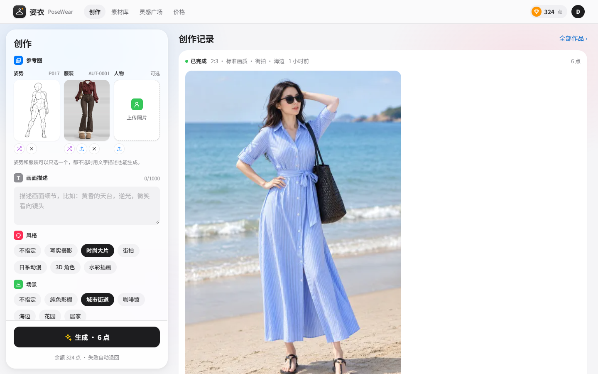
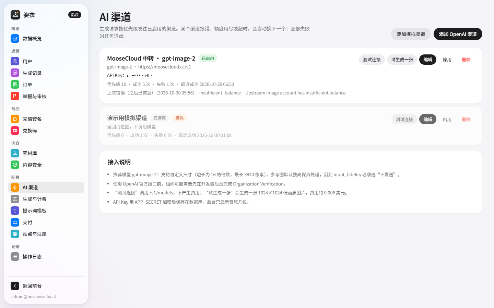

# 姿衣 PoseWear

**挑一个姿势，选一套衣服，AI 帮你拍出来。**

姿衣是由开源项目 [ai-reference-gallery](https://github.com/ZDC494225094/ai-reference-gallery) 改造而来的商用 AI 成片平台。原项目是纯静态的"姿势 + 服装"参考图拼接工具；姿衣在它的素材库之上加了账户、点数计费、支付、管理后台，以及接入 **gpt-image-2** 和 **Nano Banana**（Google Gemini）的生成队列：用户选好姿势、服装（可选人物照片），直接得到完整的人物成片。



## 功能一览

**用户端**

- **创作台**：姿势、服装、人物三个主参考，场景图和最多 3 件物品收在「更多参考」里；画幅（2:3、3:4、1:1、9:16、16:9 等）、清晰度（标准 / 2K / 4K，显示所选画幅的实际输出尺寸）、画质、风格、镜头（85mm 人像、胶片、直闪等）、真实感增强、快速场景、补充描述、张数；按钮上实时显示消耗点数。
- **人物**：上传真人照片（需授权）或虚拟人形象，复用以前上传的照片，或选自己作品里的图继续创作。虚拟人经管理员审核后可以搭配任意素材，作品可以公开。
- **素材创作**：创作台的第二个标签页。选一个大类，勾选多个小类，按性别、季节、时段细分，或加自定义细分，一次生成一批互不重复的素材，比如警察、保安、护士、工人的男女款冬装。
- **素材库**：姿势、服装、场景、物品四类。线稿姿势按组浏览，每组最多 5 个拍摄角度；服装按大类、小类整理（预置 12 个大类、88 个小类，古装按朝代、职业服装按职业细分）；场景和物品各 8 个大类；可按来源（平台 / 用户）和授权（可商用 / 非商用）筛选；支持搜索、大图预览、一键送到创作台。
- **我的素材**：按素材库的规格生成自己的姿势、服装、场景和物品，可以用文字描述，也可以上传参考图；姿势先生成一个角度，满意后再补全其他角度。素材默认私有，公开后可以设置使用点数，别人使用时作者获得分成。每次生成都记在「素材生成记录」里。
- **生成队列**：任务异步执行，卷尺式进度条；失败（含被安全审核拦截）自动退点。
- **我的作品 / 灵感广场**：卡片分小中大三档，高度一致；收藏、隐藏；详情里显示所用的全部参考，点图片看可缩放的原图；带着同样的参考回到创作台，或把作品图当作人物继续创作；下载原图、发布到广场、"用同款参考创作"、举报。
- **作品超分**：作品大图里可以把一张图按原构图重绘到 2K 或 4K，另存为新作品，原图保留（见下文「计费模型」）。
- **婚纱影楼**：上传两个人的照片，选套系（轻享 / 经典 / 臻选），为每套造型选场景（影棚、外景、中式共 12 个）、新娘和新郎礼服、发型、头饰和妆容，按套系拍出一整套婚纱照。相册里可以收藏、重拍并在多个版本里挑选、整册下载；没拍成的照片可以免费重试或退回点数。照片只有本人能看到。
- **素材库免费额度**：没有充值过的用户每类可以浏览前 30 个素材，其余显示模糊缩略图，充值后全部解锁。
- **充值**：点数套餐（支付宝电脑网站支付 / 当面付、微信 Native 扫码、易支付）、兑换码、每日签到、邀请奖励。
- **账户**：点数流水、订单、修改密码、邮箱验证与找回密码（需配置 SMTP）。
- **免费工具**：保留原项目的"参考板导出"，可以把姿势、服装、人物、场景和物品拼成一张 PNG 并附带提示词，拿去其他 AI 工具使用。

**管理后台**（`/admin`）

- **数据概览**：收入、生成量、成功率、模型成本、毛利估算、每日趋势。
- **AI 渠道**：接入 OpenAI 兼容接口（gpt-image-2 / 2.5 等）和 Google Gemini 接口（Nano Banana）；一个渠道可以挂多个模型，从接口的模型列表里多选，自动填好每个模型能出的清晰度和尺寸设置，再逐个检测实际尺寸；「清晰度分配」给标准、2K、4K 各自指定模型和顺序；每个模型可以只接部分画质，并设置自己的成本单价（按官方价、按 token 或按张，美元或人民币）；支持多渠道按优先级故障切换、并发上限、超时，以及兼容中转站的参数开关；提供"测试连接""试生成"和"检测尺寸"，按表格显示每个渠道和模型的状态。
- **生成与计费**：各画质的点数单价、清晰度倍率（附「清晰度一览」：每个画幅在各清晰度下的输出尺寸、是否实验性尺寸、模型成本和收取的点数）、开放的画幅、单次张数、作品超分的开关、点数和画质、moderation 强度、重试次数、每人限额、风格、场景和镜头预设。
- **提示词模板**：发给模型的每一段提示词都可编辑，并实时预览拼接结果。
- **用户 / 生成记录 / 订单**：调整点数、停用账号、重置密码；查看每次请求（作品或素材生成）实际发送的提示词、错误详情和 token 用量；人工确认到账。
- **套餐 / 兑换码**：批量生成兑换码并导出 CSV。
- **素材库**：姿势 / 服装 / 场景 / 物品标签页切换；按大类、小类、来源、授权、分级筛选；批量修改分级、授权和上下架；上传自有素材；AI 生成平台素材；审核用户公开的素材。
- **素材生成记录**：所有用户和平台的素材生成任务，按状态、类型、归属筛选，点开结果查看和管理。
- **虚拟人审核**：用户声明的虚拟人形象，通过或填写原因驳回。
- **素材分类**：维护大类和小类，每个小类可以写生成提示、设置分级、开关 AI 生成。
- **素材生成与分成**：用户生成素材的单价、每日次数、公开审核、使用点数上限、作者分成比例，以及生成素材用的提示词模板。
- **婚纱影楼**：「婚纱场景」管理场景、底图和示例照片，「补齐示例」一键生成缺少的底图、示例和礼服图（先给出张数和费用估算）；「套系与提示词」编辑套系、价格、镜头和成片提示词；「婚纱相册」查看所有拍摄。
- **素材浏览与防盗图**：免费额度和解锁条件、大图水印、每日查看上限、原图下载，以及访问风控记录。
- **内容安全**：违禁词、人物照片保留期、AI 生成标识（显式角标 + 隐式元数据）、广场审核、真人照片作品的公开与审核。
- **支付、站点与注册、协议文本、操作日志。**



## 快速开始（本地开发）

需要 Node.js 20.9 及以上。

```bash
cd posewear
npm install
cp .env.example .env        # 按需修改，见下文「环境变量」
```

**导入素材。** 姿势和服装图片在原项目仓库里（约 2.1GB）。克隆它，再运行导入脚本：

```bash
git clone --depth 1 https://github.com/ZDC494225094/ai-reference-gallery.git ../_upstream
npm run import:upstream -- --source ../_upstream --accept-license
```

导入脚本只写数据库，不复制图片。请在 `.env` 里把 `LIBRARY_DIR` 指向 `../_upstream/img`；如果想把图片复制进 `storage/library`，加上 `--copy`。`--accept-license` 表示你已经确认素材的使用授权（见下文「素材版权」）。

**启动。**

```bash
npm start
```

打开 http://localhost:3000 。首次启动时会用 `.env` 里的 `ADMIN_EMAIL` / `ADMIN_PASSWORD` 创建管理员。也可以随时用命令行创建：

```bash
npm run admin:create -- --email you@example.com --password 'a-long-password'
```

首次启动会预置两个渠道：一个未启用的 OpenAI gpt-image-2 渠道，以及一个非生产环境下默认启用的**模拟渠道**。模拟渠道返回占位图，用来在没有 API Key 时走通注册、扣点、生成、退点的完整流程。

## 接入 gpt-image-2

1. 登录后台，进入「AI 渠道」，编辑"OpenAI 官方 · gpt-image-2"渠道，填写 API Key。官方接口的 Base URL 是 `https://api.openai.com/v1`；用中转站时填写中转站提供的 OpenAI 兼容地址。
2. 渠道下面列着它的模型（预置的是 gpt-image-2）。要用别的模型，点"添加模型"，从接口返回的模型列表里多选；认识的模型会自动填好尺寸模式（gpt-image-2 是"自定义尺寸"）和 `input_fidelity`（gpt-image-2 不接受该参数，选"不发送"）。
3. 点「测试连接」（调用 `/v1/models`，免费），再对模型点「试生成」（1024×1024 低画质，约 0.006 美元）和「检测尺寸」（见下文）。
4. 启用该渠道，停用模拟渠道。

**请求方式。** 有参考图时调用 `POST /v1/images/edits`（multipart，参考图按 姿势 → 服装 → 人物 的顺序作为多个 `image[]` 发送）；纯文字时调用 `POST /v1/images/generations`。每个用户以哈希后的 `safety_identifier` 标识，便于 OpenAI 侧的滥用监控。

**模型与尺寸。** gpt-image-2、gpt-image-2.5-sunburst（画质更好）和 gpt-image-2.5-flare（更快，画质接近 gpt-image-2）都接受任意自定义尺寸：宽高是 16 的倍数，长宽比在 1:3 到 3:1 之间，最长边不超过 3840 像素，总像素在 655,360 到 8,294,400（3840×2160）之间；超过 3,686,400 像素（2560×1440）的输出官方标为实验性。画质 gpt-image-2 有 low / medium / high，2.5 另有 xhigh / max（本站暂不提供）。内置尺寸表都满足这些规则：

| 画幅 | 标准 | 2K（官方非实验尺寸里最大的） | 4K（实验性） |
|---|---|---|---|
| 2:3 / 3:2 | 1024×1536 | 1536×2304 | 2336×3504 |
| 3:4 / 4:3 | 1152×1536 | 1536×2048 | 2448×3264 |
| 1:1 | 1024×1024 | 1920×1920 | 2880×2880 |
| 9:16 / 16:9 | 864×1536 | 1440×2560 | 2160×3840 |

gpt-image-1.5 等旧模型只支持三档固定尺寸，模型设置里选"固定三档"，这类模型只接标准清晰度。

**中转站与 2K / 4K。** 很多中转站会忽略请求里的尺寸，只返回 1024 级别（约 157 万像素）的图。2K、4K 作品、婚纱照和超分只发给能出这个尺寸的模型；返回的图不到所要像素的 80% 时（按这张图的画幅算），这个模型会被标记为最高只能出低一档或它实际出到的清晰度，作品按实际清晰度收费并退回差价，超分则失败并全额退回；已经在排队的 2K / 4K 作品和超分会失败并全额退回，婚纱相册里剩下的照片改按标准尺寸拍完。在「AI 渠道」对模型点"检测尺寸"可以主动检查：按最高清晰度生成一张低画质图（4K 是 2336×3504），4K 没通过时再测一张 2K，结果按清晰度记在模型上。渠道换了接口、Key，或模型换了 ID、尺寸模式后，标记会清除；只改名称、优先级、启停、画质或成本不会清除。没有能出 2K 的渠道时，创作台只显示标准清晰度，婚纱照按标准尺寸拍，套系里写"高清原图"而不是"2K 高清原图"，首页和常见问题也只写现在能出的清晰度。

**故障切换。** 一个任务按「清晰度分配」（没指定时按渠道优先级）依次尝试各个模型：鉴权失败、模型不存在、额度用尽会立刻换下一个渠道；限流、超时、5xx 会换渠道并按退避重试；被内容审核拒绝的请求直接失败并退点，不会重试。

**换模型。** 新模型（如 gpt-image-2.5-sunburst / flare）上线后，在渠道里添加这个模型、检测尺寸，再在「清晰度分配」里指定它；画质档位和提示词模板都在后台可调。

**本地联调。** `npm run fake-openai` 会在 8787 端口启动一个模拟的 OpenAI 图像接口和 Gemini 接口。把 OpenAI 渠道的 Base URL 设为 `http://127.0.0.1:8787/v1`（Gemini 渠道设为 `http://127.0.0.1:8787`）、Key 填任意 `sk-` 开头的字符串，就能在不花钱的情况下测试真实的请求链路。

## 接入 Nano Banana（Google Gemini）

1. 在「AI 渠道」点"添加 Gemini 渠道"。官方接口的 Base URL 留空（即 `https://generativelanguage.googleapis.com/v1beta`），API Key 在 Google AI Studio 创建。国内服务器一般连不上 Google，要用支持 Gemini 原生格式的中转站：Base URL 填 `…/models/模型:generateContent` 前面的部分，没写 `/v1beta` 时会自动补上。
2. 点"获取模型列表"，选一个模型。中转站改过名的（如 `nano-banana-pro`、`gemini-3-pro-image-preview`）也能认出来。

   | 模型 ID | 名称 | 清晰度 | 官方价（每张） |
   |---|---|---|---|
   | gemini-3-pro-image | Nano Banana Pro | 1K / 2K / 4K | 1K、2K $0.134，4K $0.24 |
   | gemini-3.1-flash-image | Nano Banana 2 | 1K / 2K / 4K | $0.067 / $0.101 / $0.151 |
   | gemini-nano-banana-2.1 | Nano Banana 2.1 | 1K / 2K / 4K | $0.0336 / $0.0504 / $0.113 |
   | gemini-3.1-flash-lite-image | Nano Banana 2 Lite | 只有 1K | $0.0336 |
   | gemini-2.5-flash-image | Nano Banana（旧版，2027 年 3 月停用） | 只有 1K | $0.039 |

3. 点「测试连接」（读取模型列表，免费）和「试生成一张」，再启用。

**请求方式。** `POST {Base URL}/models/{模型}:generateContent`，Key 放在 `x-goog-api-key` 头里（中转站要求时可以改成 `Authorization: Bearer`）。参考图按 姿势 → 服装 → 人物 → 场景 → 物品 的顺序放在提示词前面，提示词和发给 gpt-image-2 的相同；画幅放在 `imageConfig.aspectRatio`，2K、4K 放在 `imageConfig.imageSize`，标准清晰度不发（即默认的 1K）。Nano Banana 一次只出一张图，一次要几张就同时发几个请求。

**和 gpt-image-2 的区别。**

- 没有画质参数：草稿、标准、精细出图一样，成本也一样。可以在模型的"接的画质"里只勾某几档，比如让 Pro 只接精细。
- 尺寸按画幅和 1K / 2K / 4K 给出，比 gpt-image-2 的同档尺寸略大，例如 2:3 是 848×1264、1696×2528、3392×5056。作品按实际返回的尺寸记录。
- 被安全过滤拦下（`promptFeedback.blockReason`，或 `finishReason` 是 SAFETY、IMAGE_SAFETY、PROHIBITED_CONTENT 等），或者只回了一段文字、没有出图时，作品直接失败并退点，不换渠道重试。Key 无效、模型不存在、`User location is not supported`（地区不支持）会换下一个渠道。
- 每张图都带 Google 的 SynthID 隐形水印，本站的"AI生成"标识照常加。

## 渠道、模型与清晰度分配

渠道是一个接口地址加 API Key，一个渠道可以挂多个模型。「AI 渠道」页按表格列出每个渠道和它的模型，以及每个模型在标准 / 2K / 4K 下的检测结果（✓ 通过，✗ 返回的图偏小，? 还没检测）。

1. **添加渠道。** 先填接口地址和 API Key（Gemini 渠道还可以选 Key 的传法），保存后进入下一步。
2. **添加模型。** 读取接口的模型列表（OpenAI 兼容接口是 `GET /v1/models`，Gemini 是 `GET /v1beta/models`，都不产生费用），可以多选，也可以直接填模型 ID。认识的模型排在前面，按内置的模型表填好最高清晰度、尺寸模式和 `input_fidelity`；中转站的聊天模型收在"显示全部"里。
3. **检测尺寸。** 对每个模型点"检测尺寸"，看它实际能出多大的图（会产生一到两次低画质生成的费用）。
4. **清晰度分配。** 给标准、2K、4K 各自指定用哪些模型，按顺序使用，前一个失败或满载时换下一个。某档没指定时，按渠道优先级用所有能出这个尺寸的模型；指定的模型都不能用时（停用、没有 Key、不接作品的画质），也会这样自动选择，不会让任务失败。

每个模型还有自己的设置：

- **接的画质。** 可以只接部分画质。创作台的作品只发给接这个画质的模型；创作台也只显示有模型接的画质，并按选中的画质限制可选的清晰度。婚纱照、超分和素材生成优先用接它画质的模型，没有时用其他模型。
- **成本单价。** "按官方价"时，gpt-image-2 / 2.5 和认不出的模型按「生成与计费」里的 token 单价算，gpt-image-1.5 / 1-mini 按各自的官方 token 价，Nano Banana 按张、按清晰度。中转站按次收费或打折时，选"按张单价"（标准、2K、4K 各一个价）或"按 token 单价"，可以填美元或人民币（按「生成与计费」里的汇率换算）。生成记录的成本、数据概览的毛利和「清晰度一览」都按模型的单价计算，清晰度一览可以切换按哪个模型看。

渠道级的设置有优先级、最大并发（这个渠道所有模型加起来）、超时和兼容中转站的参数开关。

## 计费模型

- 每张图消耗的点数 = 画质单价 × 清晰度倍率（向上取整），乘以张数。默认：草稿 2 点、标准 6 点、精细 18 点；2K ×1.6，4K ×2.8（默认不开放）。
- 提交时预扣点数，失败全额退回；模型返回张数不足时退还差额。
- 作品超分按次计费，默认 2K 10 点、4K 17 点，和创作台同尺寸、标准画质的价格一样。它只把那一张图和单独的超分提示词发给模型（后台「提示词模板」最后一项），按原图的比例要 2K（如 1536×2304）或 4K（如 2336×3504）的尺寸，所以只有能出这个尺寸的渠道会接这类任务。渠道没有返回更大的图时视为失败，全额退回。结果是新作品，沿用原作品的参考、人物类型和管理员隐藏状态。超分是 AI 重绘，五官、手部和小字可能有细微变化。
- **模型成本。** gpt-image-2 / 2.5 的输出按 token 计费（每百万 token：图片输出 $30、图片输入 $8、文字输入 $5）。token 数取决于尺寸和画质，但远没有像素数涨得快：2:3 标准画质的标准、2K、4K 一张分别约 $0.041、$0.064、$0.117，精细画质约 $0.165、$0.255、$0.469，1:1 更贵一些（标准 1024×1024 约 $0.053）。渠道不返回用量时，后台用和 OpenAI 计算器一致的公式按实际返回的尺寸估算输出成本（不含参考图的输入），以前的记录在升级到 1.6.1 时也按这个公式重算；gpt-image-1.5 等旧模型按 1024×1024 的单价按面积估算。Nano Banana 按张计价（见上文）。每个渠道也可以设置自己的成本单价（见「渠道的模型、画质与成本单价」）。「生成与计费」的「清晰度一览」按当前点数和充值套餐列出每个画幅的成本和收入，可以据此调整倍率。
- 默认套餐：¥9.9 / 100 点、¥29.9 / 330 点、¥99 / 1400 点（后台可改）。
- 后台按 API 返回的 token 用量估算每次生成的模型成本，并在概览页给出毛利。默认单价按 gpt-image-2 的公开价格填写（文本输入 $5、图片输入 $8、图片输出 $30，均为每百万 token），价格变动时请在「生成与计费」里更新。

## 素材体系

每个素材都有两个属性：

- **来源**：平台素材（导入的原项目素材、后台上传的素材、管理员 AI 生成的素材）或用户素材（用户自己生成的）。
- **授权**：可商用或非商用。导入的原项目素材一律标记为非商用；管理员 AI 生成的默认可商用；用户用文字生成的可商用，用参考图生成的标记为非商用，因为平台无法确认参考图的权利。管理员可以逐个或批量修改。

**AI 生成素材。** 生成时先选小类，小类的生成提示会写进提示词，用户的描述排在后面。结果统一处理成素材库的规格：姿势是 900×1200 的白底线稿，服装是 1366×2048 的整套服装图。素材不加可见角标，但文件元数据里写入 AIGC 隐式标识。姿势的"补全角度"会把已有的那张姿势图发给模型，按正面、斜侧、侧面、俯视、仰视补出同一个姿势的其他角度。

**场景与物品。** 场景是没有人物的背景照片（1536×1024），创作时作为人物所在的地点；物品是单件配饰或道具的产品图（1024×1024），创作时让人物佩戴或手持，一次最多 3 件。选了场景图后，文字的"快速场景"不再生效。

**批量创作。** 「素材创作」里每一行生成一个素材：小类 × 选中的细分（服装：男款 / 女款、春夏 / 秋冬；姿势：男 / 女；场景：白天 / 黄昏 / 夜晚、四季），再加上每个小类的自定义细分。同一批里不允许两行完全相同；任何一行校验不通过时整批不提交、不扣点。每批最多 20 个。这里生成的都是自己的素材，管理员也按单价扣点；不扣点的平台素材只能在后台「素材库」里生成。

**公开与分成。** 用户素材默认私有，只有作者自己能看到和使用，管理员能看到全部。作者公开时可以设置每次使用的点数（上限默认 50 点）。默认需要管理员审核通过才对其他人显示。其他用户用它创作时，除了生成费用，还要预扣这笔使用费。生成成功后，作者按分成比例（默认 70%）获得点数，其余归平台；生成失败则全额退回，作者不得分成。

## 素材浏览与防盗图

**免费额度。** 没有充值过的用户，每类素材只能看到排在最前面的 N 个（默认 30，姿势按组算），其余只返回名称和一张 24 像素的模糊图，不能用于创作。用户累计充值达到设定金额（默认任意金额）后解锁全部；兑换码默认也算充值。管理员可以在「用户」里为某个用户手动解锁或锁定。想让哪些素材免费，就在「素材库」里把它们排到前面。

**签发的图片链接。** 素材图片不能直接按编号访问。接口返回的链接带有签名，一到两小时后失效：登录用户的链接只对本人有效，访客的链接绑定在浏览器的 Cookie 上。浏览器不会在其他网站引用图片时带上这些 Cookie，所以盗链打不开，转发的链接也打不开。管理员和素材作者本人不受限制。作品里用到的素材缩略图、首页示例除外，这两处的链接所有人都能打开，但同样会过期。

**限流与记录。** 每个账号（访客按浏览器）和每个 IP 每小时：素材列表 600 次、缩略图 2000 张、大图 300 张、原图 60 张；每人每天大图默认 1500 张、原图 200 张。超过时请求会被拒绝，并记一条访问风控记录。大图叠加淡色水印，写着站点名和用户 ID，截图流出后能查到来源。

## 婚纱影楼

**一次拍摄是一本相册。** 套系决定造型数、每套张数和免费重拍次数，每套造型可以加拍几张；价格是套系价加上加拍费，下单时一次扣清。相册里的每张照片都是一次普通的生成任务（不另扣点），走同样的队列、渠道和安全审核，但不出现在「我的作品」和灵感广场。

**每张照片发给模型的参考图**，按顺序是：新娘的照片（最多 3 张，第一张是主照）、新郎的照片（最多 3 张）、新娘礼服图、新郎礼服图、场景底图。独照只发一个人的照片和礼服。没有礼服图或底图时，改用文字描述。提示词的每一段都可以在「套系与提示词」里改。

**重拍与退点。** 生成失败的照片可以免费重试（默认 3 次），不占套系的重拍次数；已经拍好的照片重拍先用套系的免费次数，用完后每张 40 点，旧版本保留。从没拍成功过的照片可以退回点数，金额为套系价按张数平均（向下取整）。

**示例照片**由虚拟新人按场景的推荐造型拍摄，不使用任何真人照片，只在场景上线时公开。

## 支付

在后台「支付」中配置：

| 方式 | 需要的参数 | 回调地址 |
|---|---|---|
| 支付宝电脑网站支付 / 当面付 | AppID、应用私钥、支付宝公钥（RSA2） | `https://你的域名/api/pay/notify/alipay` |
| 微信支付 Native（APIv3） | 商户号、AppID、商户证书序列号与私钥、APIv3 密钥、微信支付公钥及其 ID | `https://你的域名/api/pay/notify/wechat` |
| 易支付（彩虹易支付等兼容网关，MD5 接口） | 接口地址、商户 ID（pid）、商户密钥（key），开放的支付方式（支付宝、微信、QQ 钱包） | `https://你的域名/api/pay/notify/epay` |
| 模拟支付 | 无，仅用于联调 | — |

回调地址由系统在下单时自动传给支付平台，前提是「站点与注册」里的公网地址（或 `PUBLIC_BASE_URL`）正确。通知验签通过后才会入账，同一订单重复通知只入账一次；通知丢失时，用户点"我已支付"会主动查询订单，管理员也可以在订单页人工确认。

**易支付。** 下单方式可选跳转收银台（`submit.php`）或接口下单（`mapi.php`，网关返回二维码时直接在支付页显示）。请求和通知都用商户密钥做 MD5 签名；通知里的商户 ID、金额必须和订单一致才会入账。通知丢失时，"我已支付"会调用网关的订单查询（`api.php?act=order`，要带商户密钥，所以接口地址必须是 HTTPS）。易支付是第三方聚合网关，资金先到网关运营方，请选择可靠的服务商并定期对账。

> 签名与验签逻辑有单元测试覆盖（`test/payments.test.js`、`test/epay.test.js` 用模拟网关走完下单、通知和查询），但没有在真实商户号上联调过。正式收款前请先用支付宝沙箱或小额订单完整走一遍。

兑换码不依赖支付接口：后台批量生成后，可以在发卡平台、电商店铺或活动中发放。

## 内容安全与合规

以下规则写在代码里，后台无法关闭：

- 素材分三级：**普通**、**敏感**（性感姿势、内衣、泳装等）、**限制**（双人亲密体位等）。限制级素材永远不会发给模型，默认也不对用户展示。
- 上传人物照片必须勾选授权声明（本人或已获授权的成年人）。
- 使用真人照片时，不能搭配敏感级的服装、场景和物品，也不能搭配双人姿势；敏感级姿势（性感姿势）可以用，提示词里仍要求人物穿着完整、不做性化处理。用这类作品的图当作人物再创作，仍按真人照片处理。
- 用户可以把上传的图片声明为虚拟人（AI 生成或原创角色），但必须经管理员审核通过才按虚拟人处理；审核前它只能按真人照片使用（需另外勾选授权），或者不能使用。没用真人照片的作品图自动算虚拟人。
- 真人照片到期自动删除（默认 7 天），审核通过的虚拟人形象保留到用户删除；所有上传都会去掉 EXIF（含 GPS），并重新编码。

**用了真人照片的作品公开。** 作品默认只有自己能看到。用户每次公开前都要确认照片中的人同意公开展示，同意时间记在作品上；这类作品默认要管理员在「生成记录」里审核通过后，才出现在灵感广场和首页推荐。人物原照片始终不公开，只展示生成结果。「内容安全」里可以关闭公开（已公开的作品随即下线），或者关闭这类作品的单独审核。

可在后台调整的部分：违禁词表、敏感级素材是否可用于生成、moderation 强度、广场是否需要审核、真人照片作品能否公开和是否单独审核。

**AI 生成内容标识。** 依据《人工智能生成合成内容标识办法》，生成图默认在右下角加"AI生成"角标（显式标识），并在文件元数据中写入 `AIGC` 字段（隐式标识，字段按 GB 45438-2025 组织：PNG 写入 iTXt，WebP/JPEG 写入 XMP）。

**上线前请自行确认：**

- 面向中国大陆公众提供生成式 AI 服务，可能需要办理算法备案、生成式人工智能服务备案，以及 ICP 备案（备案号可在后台填写，显示在页脚）。使用境外模型服务的合规性，请咨询专业人士。
- 后台「站点与注册」中的用户协议、隐私政策、内容规范是模板，请按你的主体信息修改，并请律师审阅。

## 素材版权

原项目的 MIT 许可**只覆盖代码**。它的 ASSETS.md 写明，图片、缩略图和衍生索引不在许可范围内（姿势素材来自 AI Pose Gallery，服装素材来自 AI Costume Gallery）。因此导入的素材一律标记为"非商用"。商用前，请取得权利人的书面授权后在后台批量改为"可商用"，或者用后台上传、AI 生成的平台素材替换。在「素材生成与分成」里打开"只向用户展示可商用素材"后，非商用素材对用户隐藏，也不能用于生成。导入脚本要求显式加 `--accept-license` 才会运行。

AI 生成的素材标记为可商用，依据是模型服务商的条款：API 适用的 [OpenAI Services Agreement](https://openai.com/policies/services-agreement/) 约定输出归客户所有，OpenAI 把它对输出的权利转让给客户。通过中转站调用时，请同时确认中转站的条款。AI 生成内容能否受著作权保护，各地规定不同。

## 生产部署

### Docker

```bash
cp .env.example .env    # 设置 APP_SECRET、ADMIN_*、PUBLIC_BASE_URL
mkdir -p storage library
cp -r /path/to/licensed-assets/img/* library/    # 素材图片，包含 pose/ 和 costume/
docker compose build
docker compose run --rm -v /path/to/ai-reference-gallery:/upstream:ro posewear \
  node scripts/import-upstream.js --source /upstream --accept-license
docker compose up -d
```

容器以 uid 1000 的 `node` 用户运行，`storage/` 目录需要对它可写（`sudo chown -R 1000:1000 storage`）。镜像内置中文字体（文泉驿微米黑），水印文字可以正常渲染。容器只在本机 3000 端口监听，由宿主机上的 Nginx 或 Caddy 提供 HTTPS，配置示例见 [deploy/nginx.conf.example](deploy/nginx.conf.example)。

### 直接运行

```bash
NODE_ENV=production npm start
```

用 systemd、pm2 等守护进程。Linux 主机需要安装中文字体（如 `fonts-noto-cjk`），否则水印文字会显示为方框；后台「内容安全」页有水印预览，可以直接检查。

### 环境变量

| 变量 | 说明 | 默认 |
|---|---|---|
| `APP_SECRET` | 加密数据库中 API Key 和支付私钥的密钥，至少 32 位。**务必固定并备份**，丢失后已保存的密钥无法解密 | 自动生成到 `storage/.app-secret` |
| `PUBLIC_BASE_URL` | 站点公网地址，用于支付回调和邮件链接（后台也可设置） | 空 |
| `ADMIN_EMAIL` / `ADMIN_PASSWORD` | 启动时确保存在的管理员账号 | 空 |
| `PORT` / `HOST` | 监听端口和地址 | `3000` / `0.0.0.0` |
| `DATA_DIR` | 数据库、上传文件、生成结果所在目录 | `./storage` |
| `LIBRARY_DIR` | 素材图片根目录（包含 `pose/`、`costume/`） | `./storage/library` |
| `TRUST_PROXY` | Express 的 trust proxy 设置；反向代理在 Docker 网桥后时用 `loopback, uniquelocal` | `loopback` |
| `COOKIE_SECURE` | `auto` 按请求是否为 HTTPS 决定 | `auto` |
| `TZ_OFFSET_MINUTES` | 统计与订单使用的时区偏移 | `480`（东八区） |
| `OPENAI_API_KEY` / `OPENAI_BASE_URL` / `OPENAI_IMAGE_MODEL` | 仅首次启动时用于预置渠道 | 空 / 官方 / `gpt-image-2` |

### 备份与运维

- 需要备份的只有 `storage/` 目录（SQLite 数据库 `posewear.db`、用户上传、生成结果）和 `APP_SECRET`。数据库使用 WAL 模式，可以用 `sqlite3 posewear.db ".backup backup.db"` 在线备份。
- 健康检查：`GET /healthz`。
- 任务队列保存在数据库里，重启后会自动恢复中断的任务。
- 每 10 分钟清理一次：过期会话、到期的人物照片、超时未支付的订单。

## 开发

```bash
npm run dev        # 修改 server/ 后自动重启
npm test           # 端到端测试 + 支付验签单元测试
npm run check      # 全部 JS 文件语法检查
```

测试会启动真实的服务进程和模拟的 OpenAI 接口，覆盖：CSRF、注册奖励、生成扣点与退点、edits/generations 请求参数、AIGC 元数据、内容审核拦截、违禁词、人物照片的授权与分级限制、发布规则、兑换码、模拟支付幂等、重试与失败退点、数据概览，以及素材体系：分类树、授权默认值、素材规格、补全角度、私有素材的可见范围、公开审核、使用费与作者分成、失败退费、分类增删；虚拟人审核与作品图作人物的类型继承、隐藏与收藏、首页真实组合、场景与物品的生成和使用、批量创作（细分、重复和超量拦截、整批扣点，普通用户调不到平台素材接口）、镜头与真实感提示词；作品超分（尺寸、计费、退点、权限、隐藏状态的继承）；清晰度（尺寸表与成本估算、2K 只发给能出 2K 的渠道、中转返回小图时按实际清晰度收费并按画幅标记渠道、排队任务失败退点、婚纱相册改按标准拍完、尺寸检测、旧成本重算）；超分发给模型的图去掉了"AI生成"标识；中转用中文返回的审核拒绝；渠道的模型列表（OpenAI 和 Gemini 两种格式、分页、用已保存的 Key、Key 错误）；Gemini 渠道（请求格式、2K / 4K 尺寸、一次多张、安全拦截和文字回复直接退点、地区不支持时换渠道、尺寸检测）；按画质分配渠道；渠道的成本单价（按张、人民币、按 token）；渠道表的迁移。

版本记录见 [CHANGELOG.md](CHANGELOG.md)。

### 目录结构

```
posewear/
├── server/
│   ├── index.js            启动入口：中间件、路由、静态资源、任务队列
│   ├── config.js  db.js    环境变量；SQLite 连接与迁移
│   ├── middleware.js       会话、CSRF、安全头、错误处理
│   ├── routes/             public / auth / me / library / assets / studio / billing / media / admin
│   ├── services/           settings、auth、credits、library、taxonomy、asset-jobs、asset-fees、
│   │   │                   uploads、generations、worker、channels、prompt、pricing、sizes、
│   │   │                   image-post、billing、stats …
│   │   └── providers/      openai（gpt-image-2）与 mock
│   ├── payments/           alipay、wechat（RSA2 / APIv3 签名与验签）
│   └── lib/                加密、校验、限流、时间、PNG 元数据
├── public/                 前端（原生 ES 模块，无需构建）
│   ├── index.html  admin.html
│   └── assets/{css,js,img,fonts}
├── scripts/                导入素材、创建管理员、模拟 OpenAI 接口、语法检查
├── test/                   node:test 测试
├── deploy/                 Nginx 示例
└── Dockerfile  docker-compose.yml  .env.example
```

技术选型：Node.js + Express 5 + SQLite（better-sqlite3）+ sharp；前端沿用原项目的原生 HTML/CSS/JS 路线，不需要构建步骤。

## 已知限制

- 单进程 + SQLite，适合单机运营。并发更高时，需要换 PostgreSQL 并把任务队列移到 Redis 等外部队列。
- 支付宝、微信支付未在真实商户号上联调（见上文「支付」）。
- 登录方式只有邮箱 + 密码，未接入手机短信验证码和第三方登录。
- 用户界面只有简体中文。
