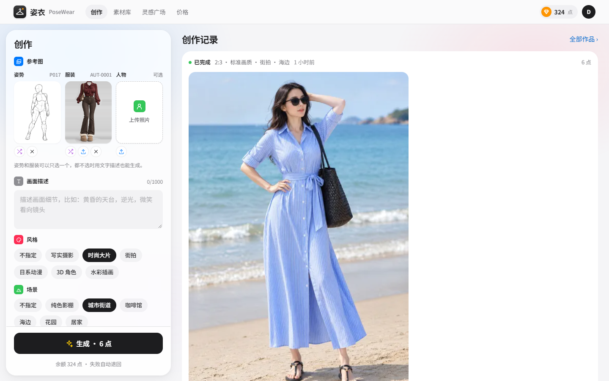
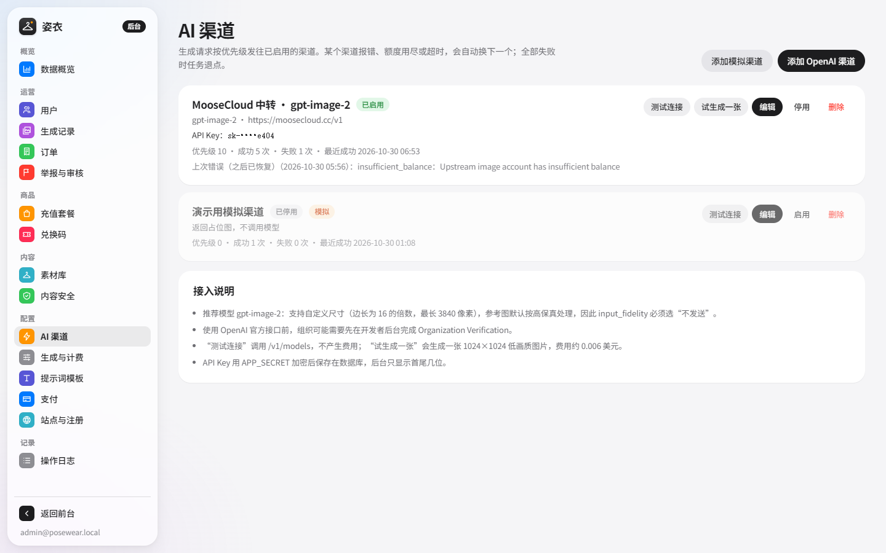

# 姿衣 PoseWear

**挑一个姿势，选一套衣服，AI 帮你拍出来。**

姿衣是由开源项目 [ai-reference-gallery](https://github.com/ZDC494225094/ai-reference-gallery) 改造而来的商用 AI 成片平台。原项目是纯静态的"姿势 + 服装"参考图拼接工具；姿衣在它的素材库之上加了账户、点数计费、支付、管理后台，以及接入 **gpt-image-2** 的生成队列：用户选好姿势、服装（可选人物照片），直接得到完整的人物成片。



## 功能一览

**用户端**

- **创作台**：姿势、服装、人物照片三个槽位；画幅（2:3、3:4、1:1、9:16、16:9 等）、清晰度（标准 / 2K / 4K）、画质、风格、场景、补充描述、张数；按钮上实时显示消耗点数。
- **素材库**：线稿姿势按组浏览，每组最多 5 个拍摄角度；服装按季节和风格分类；支持搜索、大图预览、一键送到创作台。
- **生成队列**：任务异步执行，卷尺式进度条；失败（含被安全审核拦截）自动退点。
- **我的作品 / 灵感广场**：下载原图、发布到广场、"用同款参考创作"、举报。
- **充值**：点数套餐（支付宝电脑网站支付 / 当面付、微信 Native 扫码）、兑换码、每日签到、邀请奖励。
- **账户**：点数流水、订单、修改密码、邮箱验证与找回密码（需配置 SMTP）。
- **免费工具**：保留原项目的"参考板导出"，可以把姿势、服装、人物拼成一张 PNG 并附带提示词，拿去其他 AI 工具使用。

**管理后台**（`/admin`）

- **数据概览**：收入、生成量、成功率、模型成本、毛利估算、每日趋势。
- **AI 渠道**：配置 gpt-image-2 的 API Key、Base URL、模型 ID；支持多渠道按优先级故障切换、并发上限、超时，以及兼容中转站的参数开关；提供"测试连接"和"试生成一张"。
- **生成与计费**：各画质的点数单价、清晰度倍率、开放的画幅、单次张数、moderation 强度、重试次数、每人限额、风格和场景预设。
- **提示词模板**：发给模型的每一段提示词都可编辑，并实时预览拼接结果。
- **用户 / 生成记录 / 订单**：调整点数、停用账号、重置密码；查看每次请求实际发送的提示词、错误详情和 token 用量；人工确认到账。
- **套餐 / 兑换码**：批量生成兑换码并导出 CSV。
- **素材库**：素材分级（普通 / 敏感 / 限制）、上下架、批量修改、上传自有素材。
- **内容安全**：违禁词、人物照片保留期、AI 生成标识（显式角标 + 隐式元数据）、广场审核。
- **支付、站点与注册、协议文本、操作日志。**



## 快速开始（本地开发）

需要 Node.js 20.9 及以上。

```bash
cd posewear
npm install
cp .env.example .env        # 按需修改，见下文「环境变量」
```

**导入素材。** 姿势和服装图片在原项目仓库里（约 2.1GB）。克隆它，再运行导入脚本：

```bash
git clone --depth 1 https://github.com/ZDC494225094/ai-reference-gallery.git ../_upstream
npm run import:upstream -- --source ../_upstream --accept-license
```

导入脚本只写数据库，不复制图片。请在 `.env` 里把 `LIBRARY_DIR` 指向 `../_upstream/img`；如果想把图片复制进 `storage/library`，加上 `--copy`。`--accept-license` 表示你已经确认素材的使用授权（见下文「素材版权」）。

**启动。**

```bash
npm start
```

打开 http://localhost:3000 。首次启动时会用 `.env` 里的 `ADMIN_EMAIL` / `ADMIN_PASSWORD` 创建管理员。也可以随时用命令行创建：

```bash
npm run admin:create -- --email you@example.com --password 'a-long-password'
```

首次启动会预置两个渠道：一个未启用的 OpenAI gpt-image-2 渠道，以及一个非生产环境下默认启用的**模拟渠道**。模拟渠道返回占位图，用来在没有 API Key 时走通注册、扣点、生成、退点的完整流程。

## 接入 gpt-image-2

1. 登录后台，进入「AI 渠道」，编辑"OpenAI 官方 · gpt-image-2"。
2. 填写 API Key。官方接口的 Base URL 是 `https://api.openai.com/v1`；用中转站时填写中转站提供的 OpenAI 兼容地址。
3. 模型 ID 保持 `gpt-image-2`，尺寸模式选"自定义尺寸"，`input_fidelity` 选"不发送"（gpt-image-2 不接受该参数，参考图始终按高保真处理）。
4. 点「测试连接」（调用 `/v1/models`，免费），再点「试生成一张」（1024×1024 低画质，约 0.006 美元）。
5. 启用该渠道，停用模拟渠道。

**请求方式。** 有参考图时调用 `POST /v1/images/edits`（multipart，参考图按 姿势 → 服装 → 人物 的顺序作为多个 `image[]` 发送）；纯文字时调用 `POST /v1/images/generations`。每个用户以哈希后的 `safety_identifier` 标识，便于 OpenAI 侧的滥用监控。

**尺寸。** gpt-image-2 要求宽高都是 16 的倍数、长宽比在 1:3 到 3:1 之间、最长边不超过 3840 像素，2560×1440 像素量以上属于实验范围。内置尺寸表都满足这些规则，例如 2:3 标准档为 1024×1536、2K 档为 1536×2304。gpt-image-1.5 等旧模型只支持三档固定尺寸，渠道里改选"固定三档"即可。

**故障切换。** 渠道按优先级依次尝试：鉴权失败、模型不存在、额度用尽会立刻换下一个渠道；限流、超时、5xx 会换渠道并按退避重试；被内容审核拒绝的请求直接失败并退点，不会重试。

**换模型。** 新模型（如 gpt-image-2.5-sunburst / flare）上线后，只需在渠道里改模型 ID；画质档位和提示词模板都在后台可调。

**本地联调。** `npm run fake-openai` 会在 8787 端口启动一个模拟的 OpenAI 图像接口。把渠道 Base URL 设为 `http://127.0.0.1:8787/v1`、Key 填任意 `sk-` 开头的字符串，就能在不花钱的情况下测试真实的请求链路。

## 计费模型

- 每张图消耗的点数 = 画质单价 × 清晰度倍率（向上取整），乘以张数。默认：草稿 2 点、标准 6 点、精细 18 点；2K ×1.6。
- 提交时预扣点数，失败全额退回；模型返回张数不足时退还差额。
- 默认套餐：¥9.9 / 100 点、¥29.9 / 330 点、¥99 / 1400 点（后台可改）。
- 后台按 API 返回的 token 用量估算每次生成的模型成本，并在概览页给出毛利。默认单价按 gpt-image-2 的公开价格填写（文本输入 $5、图片输入 $8、图片输出 $30，均为每百万 token），价格变动时请在「生成与计费」里更新。

## 支付

在后台「支付」中配置：

| 方式 | 需要的参数 | 回调地址 |
|---|---|---|
| 支付宝电脑网站支付 / 当面付 | AppID、应用私钥、支付宝公钥（RSA2） | `https://你的域名/api/pay/notify/alipay` |
| 微信支付 Native（APIv3） | 商户号、AppID、商户证书序列号与私钥、APIv3 密钥、微信支付公钥及其 ID | `https://你的域名/api/pay/notify/wechat` |
| 模拟支付 | 无，仅用于联调 | — |

回调地址由系统在下单时自动传给支付平台，前提是「站点与注册」里的公网地址（或 `PUBLIC_BASE_URL`）正确。通知验签通过后才会入账，同一订单重复通知只入账一次；通知丢失时，用户点"我已支付"会主动查询订单，管理员也可以在订单页人工确认。

> 签名与验签逻辑有单元测试覆盖（`test/payments.test.js`），但没有在真实商户号上联调过。正式收款前请先用支付宝沙箱或小额订单完整走一遍。

兑换码不依赖支付接口：后台批量生成后，可以在发卡平台、电商店铺或活动中发放。

## 内容安全与合规

以下规则写在代码里，后台无法关闭：

- 素材分三级：**普通**、**敏感**（性感姿势、内衣、泳装等）、**限制**（双人亲密体位等）。限制级素材永远不会发给模型，默认也不对用户展示。
- 上传人物照片必须勾选授权声明（本人或已获授权的成年人）。
- 使用人物照片时，只能搭配普通级的姿势和服装，不能搭配双人姿势；这类作品不能公开或推荐。
- 人物照片到期自动删除（默认 7 天）；所有上传都会去掉 EXIF（含 GPS），并重新编码。

可在后台调整的部分：违禁词表、敏感级素材是否可用于生成、moderation 强度、广场是否需要审核。

**AI 生成内容标识。** 依据《人工智能生成合成内容标识办法》，生成图默认在右下角加"AI生成"角标（显式标识），并在文件元数据中写入 `AIGC` 字段（隐式标识，字段按 GB 45438-2025 组织：PNG 写入 iTXt，WebP/JPEG 写入 XMP）。

**上线前请自行确认：**

- 面向中国大陆公众提供生成式 AI 服务，可能需要办理算法备案、生成式人工智能服务备案，以及 ICP 备案（备案号可在后台填写，显示在页脚）。使用境外模型服务的合规性，请咨询专业人士。
- 后台「站点与注册」中的用户协议、隐私政策、内容规范是模板，请按你的主体信息修改，并请律师审阅。

## 素材版权

原项目的 MIT 许可**只覆盖代码**。它的 ASSETS.md 写明，图片、缩略图和衍生索引不在许可范围内（姿势素材来自 AI Pose Gallery，服装素材来自 AI Costume Gallery）。商用前，请取得权利人的书面授权，或者在后台「素材库」上传你自己拥有版权的素材，并停用导入的素材。导入脚本要求显式加 `--accept-license` 才会运行。

## 生产部署

### Docker

```bash
cp .env.example .env    # 设置 APP_SECRET、ADMIN_*、PUBLIC_BASE_URL
mkdir -p storage library
cp -r /path/to/licensed-assets/img/* library/    # 素材图片，包含 pose/ 和 costume/
docker compose build
docker compose run --rm -v /path/to/ai-reference-gallery:/upstream:ro posewear \
  node scripts/import-upstream.js --source /upstream --accept-license
docker compose up -d
```

容器以 uid 1000 的 `node` 用户运行，`storage/` 目录需要对它可写（`sudo chown -R 1000:1000 storage`）。镜像内置中文字体（文泉驿微米黑），水印文字可以正常渲染。容器只在本机 3000 端口监听，由宿主机上的 Nginx 或 Caddy 提供 HTTPS，配置示例见 [deploy/nginx.conf.example](deploy/nginx.conf.example)。

### 直接运行

```bash
NODE_ENV=production npm start
```

用 systemd、pm2 等守护进程。Linux 主机需要安装中文字体（如 `fonts-noto-cjk`），否则水印文字会显示为方框；后台「内容安全」页有水印预览，可以直接检查。

### 环境变量

| 变量 | 说明 | 默认 |
|---|---|---|
| `APP_SECRET` | 加密数据库中 API Key 和支付私钥的密钥，至少 32 位。**务必固定并备份**，丢失后已保存的密钥无法解密 | 自动生成到 `storage/.app-secret` |
| `PUBLIC_BASE_URL` | 站点公网地址，用于支付回调和邮件链接（后台也可设置） | 空 |
| `ADMIN_EMAIL` / `ADMIN_PASSWORD` | 启动时确保存在的管理员账号 | 空 |
| `PORT` / `HOST` | 监听端口和地址 | `3000` / `0.0.0.0` |
| `DATA_DIR` | 数据库、上传文件、生成结果所在目录 | `./storage` |
| `LIBRARY_DIR` | 素材图片根目录（包含 `pose/`、`costume/`） | `./storage/library` |
| `TRUST_PROXY` | Express 的 trust proxy 设置；反向代理在 Docker 网桥后时用 `loopback, uniquelocal` | `loopback` |
| `COOKIE_SECURE` | `auto` 按请求是否为 HTTPS 决定 | `auto` |
| `TZ_OFFSET_MINUTES` | 统计与订单使用的时区偏移 | `480`（东八区） |
| `OPENAI_API_KEY` / `OPENAI_BASE_URL` / `OPENAI_IMAGE_MODEL` | 仅首次启动时用于预置渠道 | 空 / 官方 / `gpt-image-2` |

### 备份与运维

- 需要备份的只有 `storage/` 目录（SQLite 数据库 `posewear.db`、用户上传、生成结果）和 `APP_SECRET`。数据库使用 WAL 模式，可以用 `sqlite3 posewear.db ".backup backup.db"` 在线备份。
- 健康检查：`GET /healthz`。
- 任务队列保存在数据库里，重启后会自动恢复中断的任务。
- 每 10 分钟清理一次：过期会话、到期的人物照片、超时未支付的订单。

## 开发

```bash
npm run dev        # 修改 server/ 后自动重启
npm test           # 端到端测试 + 支付验签单元测试
npm run check      # 全部 JS 文件语法检查
```

测试会启动真实的服务进程和模拟的 OpenAI 接口，覆盖：CSRF、注册奖励、生成扣点与退点、edits/generations 请求参数、AIGC 元数据、内容审核拦截、违禁词、人物照片的授权与分级限制、发布规则、兑换码、模拟支付幂等、重试与失败退点、数据概览。

### 目录结构

```
posewear/
├── server/
│   ├── index.js            启动入口：中间件、路由、静态资源、任务队列
│   ├── config.js  db.js    环境变量；SQLite 连接与迁移
│   ├── middleware.js       会话、CSRF、安全头、错误处理
│   ├── routes/             public / auth / me / library / studio / billing / media / admin
│   ├── services/           settings、auth、credits、library、uploads、generations、worker、
│   │   │                   channels、prompt、pricing、sizes、image-post、billing、stats …
│   │   └── providers/      openai（gpt-image-2）与 mock
│   ├── payments/           alipay、wechat（RSA2 / APIv3 签名与验签）
│   └── lib/                加密、校验、限流、时间、PNG 元数据
├── public/                 前端（原生 ES 模块，无需构建）
│   ├── index.html  admin.html
│   └── assets/{css,js,img,fonts}
├── scripts/                导入素材、创建管理员、模拟 OpenAI 接口、语法检查
├── test/                   node:test 测试
├── deploy/                 Nginx 示例
└── Dockerfile  docker-compose.yml  .env.example
```

技术选型：Node.js + Express 5 + SQLite（better-sqlite3）+ sharp；前端沿用原项目的原生 HTML/CSS/JS 路线，不需要构建步骤。

## 已知限制

- 单进程 + SQLite，适合单机运营。并发更高时，需要换 PostgreSQL 并把任务队列移到 Redis 等外部队列。
- 支付宝、微信支付未在真实商户号上联调（见上文「支付」）。
- 登录方式只有邮箱 + 密码，未接入手机短信验证码和第三方登录。
- 用户界面只有简体中文。
